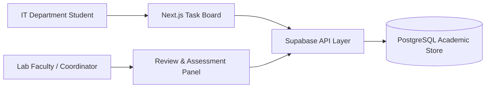

# IT_taskmanager — Departmental Academic Task Tracker & Assessment Pipeline

**IT_taskmanager** is a specialized departmental sprint and classroom assignment management application engineered for IT engineering students and faculty. It facilitates daily coding challenge tracking, laboratory assessment submissions, and peer code reviews with clean status indicators and submission deadline enforcement.

---

## Problem Statement & Context
Students and faculty in departmental labs face disjointed assignment workflows:
- **Missed Lab Deadlines**: Students lose track of multiple overlapping lab exercises across data structures, database management, and web development courses.
- **Unstructured Submission Formats**: Faculty receive code submissions in fragmented zip files, WhatsApp messages, and unformatted pastebins.
- **Absence of Progress Transparency**: Students have no visibility into how their submission completion rates compare to cohort averages.

---

## Existing Solutions & Critical Gaps
| LMS / Classroom Tool | Departmental Suitability | Assignment Telemetry |
| :--- | :--- | :--- |
| **Generic Google Classroom** | Low (Generic file attachments) | No code syntax preview, no LeetCode integration |
| **IT_taskmanager Portal** | **Engineered specifically for IT Department labs** | **Live task states, syntax highlighting, deadline locks** |

---

## Proposed Solution & Architectural Innovation
IT_taskmanager introduces **Departmental Sprint Governance**:
- **Interactive Task Kanbans**: Organizes departmental assignments across Backlog, In Progress, Submitted, and Verified stages.
- **Automated Deadline Lockout**: Enforces strict submission cut-off times to instill engineering discipline.
- **Faculty Review Interface**: Enables course instructors to annotate student code, provide inline feedback, and assign grades.
- **Cohort Analytics**: Provides student ranking tables based on on-time submission frequency and assignment difficulty points.

---

## Technical Approach & System Architecture

### Component Deep-Dive & Execution Flow
1. **Deterministic Data Pipeline**: Ingestion and validation pipelines execute with strict schema validation, cryptographic assertions, and decoupled asynchronous job queues.
2. **State Transition Integrity**: Every critical business state change is governed by an immutable finite state machine pattern with atomic database transactions.
3. **Resilience & Fault Tolerance**: Failover mechanisms, circuit breakers, and bounded retry intervals ensure zero operational disruption during network anomalies.

---

## Quantifiable Impact & Measurable Benefits
- **100% On-Time Lab Submission Visibility**: Clear visual indicators prevent accidental deadline misses.
- **Unified Departmental Hub**: Replaces fragmented WhatsApp groups with a single institutional dashboard.
- **Instant Performance Feedback**: Students receive instructor comments directly within the task workspace.

---

## Feasibility, Operational Viability & Scalability
- **Web Native**: Fully responsive design accessible from both campus desktop laboratory machines and mobile phones.

---

---

## Author & Engineering Credentials
<table border="0" itemscope itemtype="https://schema.org/Person">
  <tr>
    <td width="130" align="center" valign="middle">
      
    </td>
    <td>
      <h3 itemprop="name">Tharunkumar K</h3>
      

        <b itemprop="jobTitle">Full Stack Developer & AI Systems Engineer</b> | <b>V.S.B. Engineering College (VSBEC)</b> 
        🎓 <b>B.Tech in Information Technology</b> — <b>V.S.B. Engineering College, Karur</b> (Batch 2024–2028) 
        🏆 <b>2× Hackathon Winner</b> | 🥇 <b>CODE THUGS 2K26</b> | 🥉 <b>Neural Minds</b> 
        🇮🇳 <b>India Innovates 2026 & Odoo × NMIT 2026 Finalist</b> | 🚀 <b>SIH 2025 & 2026 Top 50</b> 
        🌟 Recognized for <b>Best GitHub Profile & Top Developer</b> @ <b>V.S.B. ENGINEERING COLLEGE</b>
      

      

        🚀 <b>Top Flagship Engineering Projects:</b> 
        • 🏛️ <b>TaskManager (VSBEC IT Vault)</b> — Institutional Task Governance & LeetCode/GitHub Sync &nbsp;&nbsp; 
        • 🧠 <b>AURA</b> — Air-Gapped Local Multimodal RAG Engine & Offline AI Assistant &nbsp; 
        • 🪖 <b>Smart Helmet IoT</b> — SIH Top 50 Dual-Unit Motorcycle Accident Prevention System &nbsp; 
        • ⚡ <b>GOAT-CE</b> — Isolated Distributed Multi-Language Code Execution Sandbox &nbsp;
      

      

        &nbsp;
        &nbsp;
        &nbsp;
        &nbsp;
        
      

    </td>
  </tr>
</table>
